# Práctica 3.4 – Estilos de vida entre generaciones

| Campo | Detalle |
|---|---|
| Asignatura | Desarrollo Sustentable (ACD-0908) |
| Carrera | Ingeniería en Sistemas Computacionales |
| Institución | Tecnológico Nacional de México – Campus Mazatlán |
| Unidad / Tema | 3. Escenario socio-cultural / 3.4 Estilos de vida, consumo y estrategias de sustentabilidad |
| Práctica | 3.4-P8 Página web "Estilos de vida entre generaciones" |
| Integrante | Cesar Jesus Gamez Mendoza (individual) |
| Herramientas | IA generativa, Make (Custom webhook, Make AI Agent, Webhook response), GitHub Pages |
| Página publicada | [https://cesargm-max.github.io/3.4-Pagina-web-Estilos-de-vida-entre-generaciones/](https://cesargm-max.github.io/3.4-Pagina-web-Estilos-de-vida-entre-generaciones/) |
| Video | Enlace en [`video/enlace.txt`](video/enlace.txt) |

## Estructura del repositorio

| Carpeta / archivo | Contenido |
|---|---|
| `README.md` | Este reporte técnico con explicaciones y respuestas a las preguntas de reflexión. |
| `codigo/` | `index.html` (página web) y `blueprint.json` (escenario de Make exportado). |
| `imagenes/` | Capturas del escenario completo de Make y de la página funcionando. |
| `video/enlace.txt` | Enlace al video de YouTube con la prueba en vivo. |
| `resultados/` | PDF con lo que se aprendió en la práctica. |

## Introducción

La forma en que una familia se alimenta, se viste, se transporta o maneja su basura ha cambiado mucho en tres generaciones. Algunos hábitos de los abuelos eran más sustentables por necesidad (reparar, reutilizar, comprar a granel) y algunos de hoy son mejores por la información y la tecnología (reciclaje, energías limpias). En esta práctica se entrevistó a tres generaciones de mi familia y comunidad, se capturaron sus respuestas en una página web y una inteligencia artificial las compara y propone conclusiones, que analizo con criterio propio.

## Objetivo

Distinguir los estilos de vida y de consumo de tres generaciones de mi entorno, construir sin programar una página web conectada a Make e IA para comparar sus respuestas y formular conclusiones propias sobre la sustentabilidad de esos hábitos.

## Desarrollo

| Actividad | Qué se hizo |
|---|---|
| 1. Cuestionario | Se prepararon 8 preguntas iguales para las tres personas (comida, ropa, electrónicos, transporte, basura, desechables, agua y qué se considera necesario para vivir bien). El abuelo/a y el padre/madre respondieron pensando en cuando tenían entre 18 y 25 años; el amigo/a respondió sobre el presente. |
| 2. Entrevistas | Se entrevistó a las tres personas con las mismas 8 preguntas y se anotaron sus respuestas tal como las dieron. De cada una se registró solo la edad (75, 46 y 19 años), sin nombres ni otros datos personales. |
| 3. Webhook | En Make se creó el escenario **Generaciones** con un **Custom webhook** llamado `Generaciones_Equipo1`. |
| 4. Página con IA | Se generó `index.html` (un solo archivo con CSS y JS): título y explicación, tres secciones (abuelo/a, padre/madre, amigo/a) con campo numérico "Edad" y 8 áreas de texto, botón "Comparar respuestas" con validación de campos, envío con `fetch` por `POST` y `URLSearchParams` con los campos `abuelo`, `padre` y `amigo`, mensaje "Analizando respuestas...", respuesta en texto plano con `white-space: pre-line`, mensaje de error y diseño responsive en tonos ambientales. |
| 5. Estructura de datos | Con **Run once** activo se envió una consulta y el webhook detectó los campos `abuelo`, `padre` y `amigo`. |
| 6. Make AI Agent | Conexión *Make's AI Provider* (sin Knowledge), Input con `{{1.abuelo}}`, `{{1.padre}}` y `{{1.amigo}}` e instrucciones que obligan a usar únicamente lo que dicen las respuestas y a responder en texto plano con formato fijo (comparación por tema, análisis y conclusiones). |
| 7. Respuesta | **Webhook response** con status 200, cuerpo = respuesta del agente y headers `Content-Type: text/plain; charset=utf-8` y `Access-Control-Allow-Origin: *`. Escenario guardado y activo con **Immediately as data arrives**. |
| 8. Publicar y analizar | `index.html` publicado con GitHub Pages; se capturaron las tres entrevistas reales, se leyó el análisis de la IA, se verificó contra las respuestas originales y se revisaron los créditos consumidos. |

## Código

La carpeta [`codigo/`](codigo/) contiene [`index.html`](codigo/index.html) (publicado en GitHub Pages) y [`blueprint.json`](codigo/blueprint.json), el escenario de Make exportado (Custom webhook → Make AI Agent → Webhook response).

```html
<!DOCTYPE html>
<html lang="es">
<head>
<meta charset="UTF-8">
<meta name="viewport" content="width=device-width, initial-scale=1">
<title>Estilos de vida entre generaciones</title>
<style>
  :root {
    --verde-oscuro: #1f4d2b;
    --verde: #2e7d46;
    --verde-claro: #e6f2e6;
    --tierra: #8a6d3b;
    --cielo: #dff0f7;
    --texto: #1d2b20;
  }
  * { box-sizing: border-box; }
  body {
    margin: 0;
    font-family: "Segoe UI", Roboto, Arial, sans-serif;
    color: var(--texto);
    background: linear-gradient(180deg, var(--cielo) 0%, var(--verde-claro) 100%);
    min-height: 100vh;
    line-height: 1.5;
  }
  header { background: var(--verde-oscuro); color: #fff; padding: 28px 16px; text-align: center; }
  header h1 { margin: 0 0 6px; font-size: clamp(1.6rem, 5vw, 2.4rem); }
  header p { margin: 0; opacity: .9; }
  main { max-width: 1100px; margin: 0 auto; padding: 20px 16px 40px; }
  .tarjeta {
    background: #fff;
    border-radius: 14px;
    padding: 20px;
    box-shadow: 0 4px 14px rgba(31, 77, 43, .15);
    margin-bottom: 20px;
    border-left: 6px solid var(--verde);
  }
  .tarjeta h2 { margin-top: 0; color: var(--verde-oscuro); font-size: 1.2rem; }
  .columnas { display: grid; grid-template-columns: repeat(3, 1fr); gap: 16px; }
  .persona { background: #fff; border-radius: 14px; padding: 16px; box-shadow: 0 4px 14px rgba(31, 77, 43, .15); border-top: 6px solid var(--verde); }
  .persona h2 { margin: 0 0 12px; color: var(--verde-oscuro); font-size: 1.15rem; }
  .persona label { display: block; font-weight: 600; font-size: .9rem; margin: 12px 0 4px; }
  input[type="number"], textarea {
    width: 100%;
    font: inherit;
    padding: 8px 10px;
    border: 2px solid #b9d6bf;
    border-radius: 8px;
    color: var(--texto);
    background: #fcfffc;
  }
  textarea { min-height: 64px; resize: vertical; }
  input:focus, textarea:focus { outline: none; border-color: var(--verde); }
  .acciones { text-align: center; margin-top: 8px; }
  button {
    font-size: 1.05rem;
    padding: 12px 28px;
    border-radius: 10px;
    border: 2px solid var(--verde);
    background: var(--verde);
    color: #fff;
    font-weight: 700;
    cursor: pointer;
  }
  button:hover:not(:disabled) { background: var(--verde-oscuro); }
  button:disabled { opacity: .6; cursor: not-allowed; }
  #aviso { margin-top: 12px; color: #7a1f1f; font-weight: 600; min-height: 1.2em; }
  #resultado {
    margin-top: 18px;
    padding: 16px;
    background: var(--verde-claro);
    border: 2px dashed var(--verde);
    border-radius: 10px;
    white-space: pre-line;
    min-height: 60px;
    overflow-wrap: anywhere;
    text-align: left;
  }
  #resultado.error { background: #fbeaea; border-color: #b03a3a; color: #7a1f1f; }
  footer { text-align: center; font-size: .85rem; color: var(--tierra); padding: 0 16px 24px; }
  @media (max-width: 800px) {
    .columnas { grid-template-columns: 1fr; }
    button { width: 100%; }
  }
</style>
</head>
<body>
<header>
  <h1>Estilos de vida entre generaciones</h1>
  <p>Desarrollo Sustentable · TecNM Campus Mazatlán</p>
</header>

<main>
  <section class="tarjeta">
    <h2>¿De qué trata esta página?</h2>
    <p>
      Se entrevistó a tres generaciones sobre sus hábitos de consumo para compararlos: un abuelo o abuela,
      un padre o madre y un amigo o amiga. El abuelo y el padre responden pensando en cuando tenían entre
      18 y 25 años; el amigo responde sobre el presente. Al final, una inteligencia artificial compara
      las respuestas y propone conclusiones.
    </p>
  </section>

  <div class="columnas" id="columnas"></div>

  <div class="acciones">
    <button id="comparar" type="button">Comparar respuestas</button>
    <div id="aviso" role="alert"></div>
  </div>

  <section class="tarjeta" style="margin-top:20px">
    <h2>Análisis de la IA</h2>
    <div id="resultado" aria-live="polite"></div>
  </section>
</main>

<footer>Práctica 3.4 · Estilos de vida, consumo y estrategias de sustentabilidad.</footer>

<script>
  // PEGA AQUI LA URL DEL WEBHOOK DE MAKE
  const WEBHOOK_URL = "https://hook.us2.make.com/5eqv13elaer5x6qiguqqqdyljpcdarjo";

  const PREGUNTAS = [
    "¿Cómo se conseguía la comida en casa: mercado, tienda, súper o cultivo propio?",
    "¿Qué se hacía con la ropa o los zapatos viejos o rotos?",
    "¿Qué aparatos electrónicos tenías y cada cuánto los cambiabas?",
    "¿Cómo te transportabas a la escuela o al trabajo?",
    "¿Qué se hacía con la basura? ¿Se separaba o se reutilizaba algo?",
    "¿Usabas bolsas, botellas o envases desechables?",
    "¿Cómo se usaba y se cuidaba el agua en casa?",
    "¿Qué consideras necesario para vivir bien?"
  ];
  const PERSONAS = [
    { id: "abuelo", titulo: "Abuelo/a" },
    { id: "padre", titulo: "Padre/Madre" },
    { id: "amigo", titulo: "Amigo/a" }
  ];

  const columnas = document.getElementById("columnas");
  const boton = document.getElementById("comparar");
  const aviso = document.getElementById("aviso");
  const resultado = document.getElementById("resultado");

  // Construye las tres secciones con su campo de edad y las 8 preguntas
  PERSONAS.forEach(p => {
    const sec = document.createElement("section");
    sec.className = "persona";
    let html = '<h2>' + p.titulo + '</h2>' +
      '<label for="' + p.id + '-edad">Edad</label>' +
      '<input type="number" id="' + p.id + '-edad" min="1" max="120" inputmode="numeric">';
    PREGUNTAS.forEach((q, i) => {
      html += '<label for="' + p.id + '-' + (i + 1) + '">' + (i + 1) + '. ' + q + '</label>' +
        '<textarea id="' + p.id + '-' + (i + 1) + '"></textarea>';
    });
    sec.innerHTML = html;
    columnas.appendChild(sec);
  });

  function campoVacio(id) {
    return document.getElementById(id).value.trim() === "";
  }

  function textoDe(id) {
    let t = "Edad: " + document.getElementById(id + "-edad").value.trim() + "\n";
    PREGUNTAS.forEach((q, i) => {
      t += (i + 1) + ". " + q + ": " + document.getElementById(id + "-" + (i + 1)).value.trim() + "\n";
    });
    return t.trim();
  }

  boton.addEventListener("click", async () => {
    aviso.textContent = "";
    // Verifica que todos los campos estén llenos antes de enviar
    const faltan = PERSONAS.some(p => {
      if (campoVacio(p.id + "-edad")) return true;
      return PREGUNTAS.some((q, i) => campoVacio(p.id + "-" + (i + 1)));
    });
    if (faltan) {
      aviso.textContent = "Faltan campos por llenar. Completa la edad y las 8 respuestas de las tres personas.";
      return;
    }

    boton.disabled = true;
    resultado.className = "";
    resultado.textContent = "Analizando respuestas, esto puede tardar unos segundos...";
    try {
      const cuerpo = new URLSearchParams();
      cuerpo.append("abuelo", textoDe("abuelo"));
      cuerpo.append("padre", textoDe("padre"));
      cuerpo.append("amigo", textoDe("amigo"));
      const respuesta = await fetch(WEBHOOK_URL, { method: "POST", body: cuerpo });
      if (!respuesta.ok) throw new Error("HTTP " + respuesta.status);
      resultado.textContent = await respuesta.text();
    } catch (error) {
      resultado.className = "error";
      resultado.textContent = "No se pudo obtener el análisis, intenta de nuevo.";
    } finally {
      boton.disabled = false;
    }
  });
</script>
</body>
</html>
```

## Imágenes

Todas las capturas están en la carpeta [`imagenes/`](imagenes/). Primero se muestra el escenario completo en Make, ordenado de izquierda a derecha (Webhook → Make AI Agent → Webhook response), y después la página funcionando.

**Figura 1. Escenario `Generaciones` completo y activo.** Se ven los tres módulos en orden, el estado *Active* y el uso de créditos.

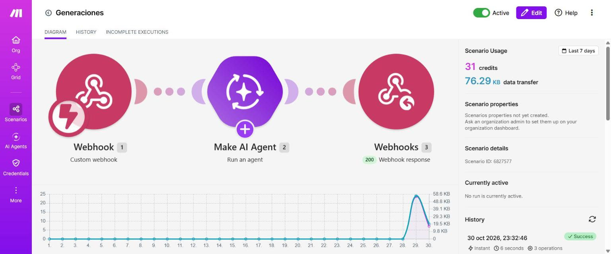

**Figura 2. Escenario en el editor con "Immediately as data arrives".** Los módulos 1, 2 y 3 conectados; el webhook responde con status 200.

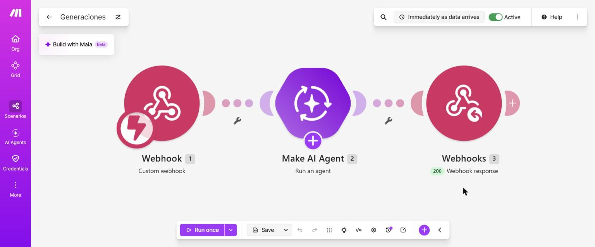

**Figura 3. Módulo Custom webhook con los datos detectados.** Make detectó los tres campos que envía la página: `abuelo`, `padre` y `amigo`.

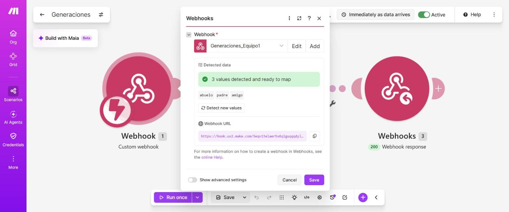

**Figura 4. Make AI Agent – conexión, modelo e instrucciones.** Conexión *Make's AI Provider*, modelo Medium e instrucciones que obligan a usar solo lo que dicen las respuestas.

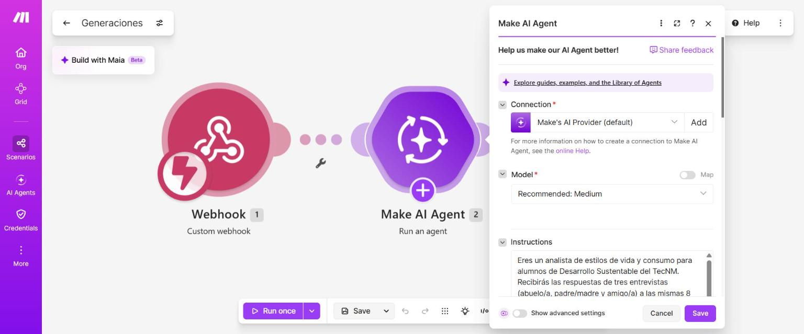

**Figura 5. Make AI Agent – Input.** Las variables `{{1.abuelo}}`, `{{1.padre}}` y `{{1.amigo}}` mapeadas desde el webhook.

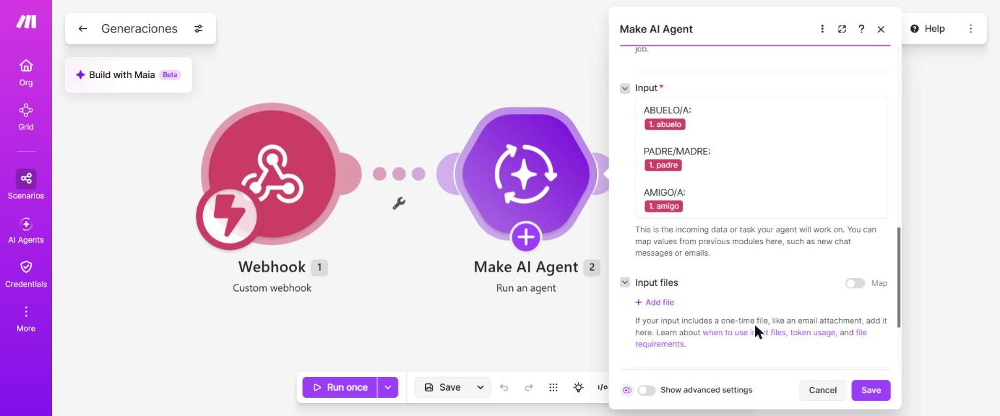

**Figura 6. Webhook response.** Status 200, cuerpo `2. Response` (la respuesta del agente) y header `Content-Type: text/plain; charset=utf-8`.

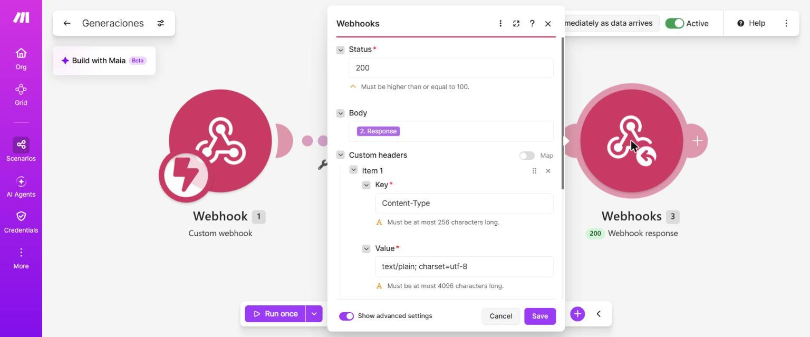

**Figura 7. Historial de ejecuciones y créditos.** Cada análisis terminó en *Success* y consumió entre 3.13 y 3.64 créditos.

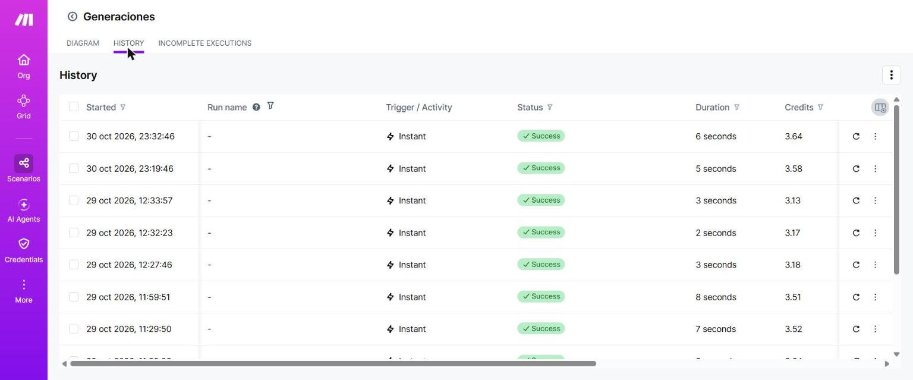

**Figura 8. Página publicada, vacía.** Título, explicación y las tres secciones con campo de edad y 8 preguntas.

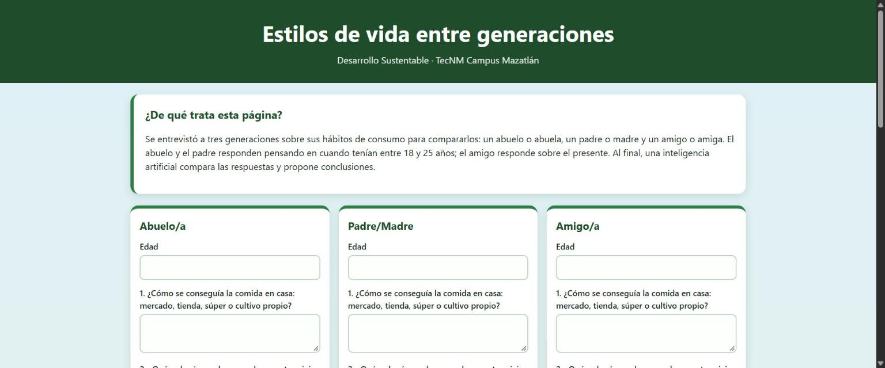

**Figura 9. Página con las respuestas reales capturadas.** Edades 75, 46 y 19 años.

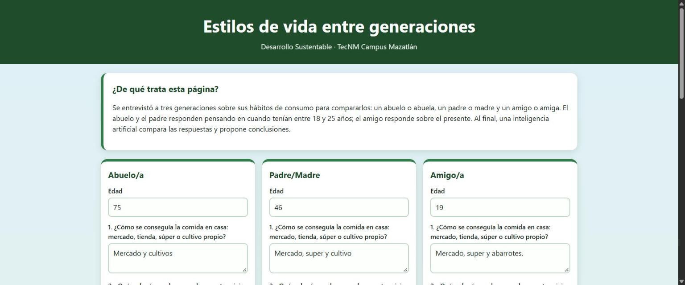

**Figura 10. Mensaje de espera.** Al presionar "Comparar respuestas" la página muestra "Analizando respuestas...".

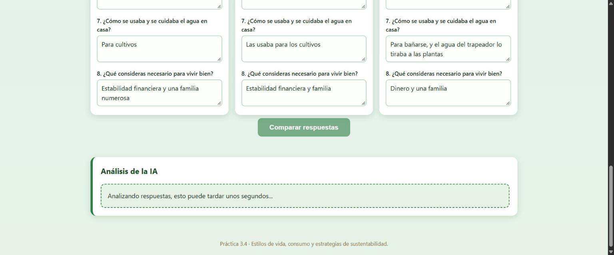

**Figura 11. Resultado del análisis de la IA.** Comparación por tema, análisis y conclusiones devueltos por el Make AI Agent.

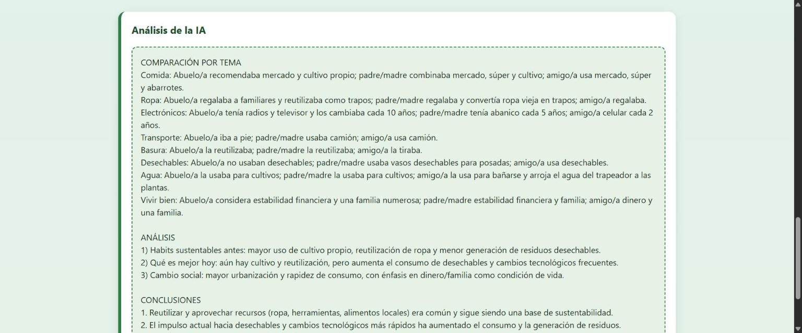

## Video

La prueba en vivo está en YouTube: [https://youtube.com/shorts/SWjVJk6-o-M](https://youtube.com/shorts/SWjVJk6-o-M). El mismo enlace está en [`video/enlace.txt`](video/enlace.txt).

## Resultados

El PDF con lo que aprendí en esta práctica está en [`resultados/aprendizaje_practica_3_4.pdf`](resultados/aprendizaje_practica_3_4.pdf).

### Comparación de las tres generaciones

Respuestas capturadas en la página (resumidas):

| Tema | Abuelo/a (75 años) | Padre/Madre (46 años) | Amigo/a (19 años) |
|---|---|---|---|
| Comida | Mercado y cultivos | Mercado, súper y cultivo | Mercado, súper y abarrotes |
| Ropa | La regalaba a familiares y la reutilizaba como trapos | La regalaba y la ropa vieja la usaba para trapos | La regalaba |
| Electrónicos | Radios y televisor, cada 10 años | Abanico, cada 5 años | Celular (5), cada 2 años |
| Transporte | A pie | Camión | Camión |
| Basura | La reutilizaba | La reutilizaba | La tiraba |
| Desechables | No usaban | Sí, vasos desechables para posadas | Sí |
| Agua | Para cultivos | Para cultivos | Para bañarse; el agua del trapeador la tiraba a las plantas |
| Vivir bien | Estabilidad financiera y una familia numerosa | Estabilidad financiera y familia | Dinero y una familia |

Lo que devolvió la IA en la prueba de la Figura 11, en resumen: antes había más cultivo propio, reutilización de ropa y menos desechables; hoy aumentan los desechables y el cambio rápido de aparatos; y como acción concreta propuso retomar el cultivo propio o la reutilización de prendas y objetos, con redes de intercambio familiar.

Nota: el abuelo/a y el padre/madre contestaron pensando en cuando tenían entre 18 y 25 años, y el amigo/a contestó sobre el presente. Por eso la comparación es entre épocas distintas, no entre personas de la misma edad.

### Créditos consumidos

En el historial del escenario (Figura 7) cada análisis consumió entre **3.13 y 3.64 créditos**, es decir, alrededor de 3.5 créditos por ejecución. El panel del escenario (Figura 1) muestra 31 créditos en los últimos 7 días, contando las pruebas y las grabaciones del video. Con un plan de créditos limitado, cada vez que alguien presiona "Comparar respuestas" se gasta saldo, por lo que conviene no repetir el análisis sin necesidad.

### Verificación del análisis de la IA

Revisé el análisis contra las respuestas originales (sección anterior):

- **Lo que sí coincide:** la tabla "Comparación por tema" respeta las respuestas: las edades de cambio de aparatos (10, 5 y 2 años), el transporte (a pie, camión, camión), que el abuelo/a no usaba desechables y que el amigo/a tiraba la basura. Esa parte la IA la resumió bien.
- **Lo que inventó o interpretó de más:** en el análisis dijo que el cambio social se explica por "mayor urbanización". Nadie mencionó eso en las entrevistas; es una suposición de la IA aunque sus instrucciones decían no inventar datos. En otra prueba escribió "abuela" cuando yo solo había puesto "abuelo/a".
- **Lo que dejó fuera:** del amigo/a escribió "celular cada 2 años" pero omitió el "5" que aparece en su respuesta. Tampoco distinguió que dos personas hablaban del pasado y una del presente, y no dijo con claridad qué hábitos de hoy son mejores, que era parte de lo pedido.
- **Errores de redacción:** palabras mal escritas como "recomendaba" y "Habits".
- **Resultados distintos entre pruebas:** con las mismas respuestas, la IA no devolvió exactamente el mismo texto en dos ejecuciones; por eso su análisis sirve de apoyo, pero la conclusión final tiene que revisarla una persona.

## Preguntas de reflexión

**1. ¿Qué generación tiene el estilo de vida más sustentable según sus respuestas? ¿Fue por convicción o por necesidad?**

Según las respuestas, el del abuelo/a: iba a pie, no usaba desechables, reutilizaba la basura y la ropa, usaba el agua para cultivos y cambiaba sus aparatos cada 10 años. Por lo que dijeron, parece haber sido más por necesidad que por convicción: en ninguna respuesta aparece una razón ambiental, y lo que consideraban necesario para vivir bien era la estabilidad financiera y una familia numerosa. Esto es una interpretación mía, porque no se les preguntó el motivo.

**2. ¿Qué cambios en la sociedad (publicidad, tecnología, ingreso, ciudad) explican las diferencias de consumo entre las tres generaciones?**

Lo que se ve en las respuestas es el cambio de la tecnología (de radios y televisor cada 10 años a un celular cada 2 años), el mayor acceso a supermercados y abarrotes, la aparición de los desechables y el transporte por camión en lugar de caminar. Mi hipótesis es que la publicidad y el consumo rápido influyen en esos cambios, pero eso no se preguntó directamente en las entrevistas. Es notable que el amigo/a, a diferencia de los mayores, puso "dinero" como necesario para vivir bien.

**3. ¿Están de acuerdo con el análisis de la IA? ¿Qué dejó fuera o qué interpretó mal?**

En general estoy de acuerdo con la comparación por tema, porque coincide con lo que respondieron las personas. No estoy de acuerdo con que explicara el cambio por "mayor urbanización", porque eso no salió en las entrevistas, y noté que omitió detalles (el "5" de los celulares), no separó pasado de presente y cometió errores de redacción. El detalle completo está en la sección "Verificación del análisis de la IA".

**4. ¿Qué relación tienen estos hábitos con los principios de la Carta de la Tierra o con la Agenda 21?**

Reutilizar la ropa, no usar desechables, aprovechar el agua para cultivos y cultivar alimentos se relacionan con el pilar de **integridad ecológica** de la Carta de la Tierra (usar los recursos con cuidado y prevenir daños al ambiente) y con el de **respeto y cuidado de la comunidad de la vida**. En la Agenda 21 se relacionan con el capítulo sobre cambio de las modalidades de consumo (capítulo 4) y con el manejo de residuos (capítulo 21), que buscan reducir y reutilizar. Los hábitos actuales, como el uso de desechables y el cambio frecuente de aparatos, van en sentido contrario.

**5. ¿Qué hábito de generaciones anteriores están dispuestos a retomar y cómo lo harían?**

Retomaría la reutilización: darle otro uso a la ropa vieja (por ejemplo, trapos) o regalarla, evitar los desechables llevando mi propia bolsa y mi propio envase, y reutilizar el agua del trapeador o del enjuague para regar plantas, como ya hizo el amigo/a entrevistado. Son cambios pequeños que no cuestan dinero y reducen la basura.

## Conclusiones

Las generaciones mayores consumían menos y reutilizaban más, y los hábitos actuales (desechables, aparatos que se cambian cada pocos años, transporte motorizado) generan más residuos. Esa sustentabilidad parece haber sido más de necesidad que de convicción, así que hoy hace falta hacerla una decisión consciente. Con Make y un agente de IA pude armar sin programar un flujo que compara las respuestas en segundos, pero el análisis automático tiene errores e invenciones, por lo que siempre hay que contrastarlo con los datos originales. Además, cada ejecución consume créditos, y vale la pena usarlos con intención.

## Fuente

Entrevistas realizadas a tres personas (abuelo/a, padre/madre y amigo/a) de mi familia y comunidad; análisis comparativo generado con Make AI Agent a partir de las respuestas capturadas.
